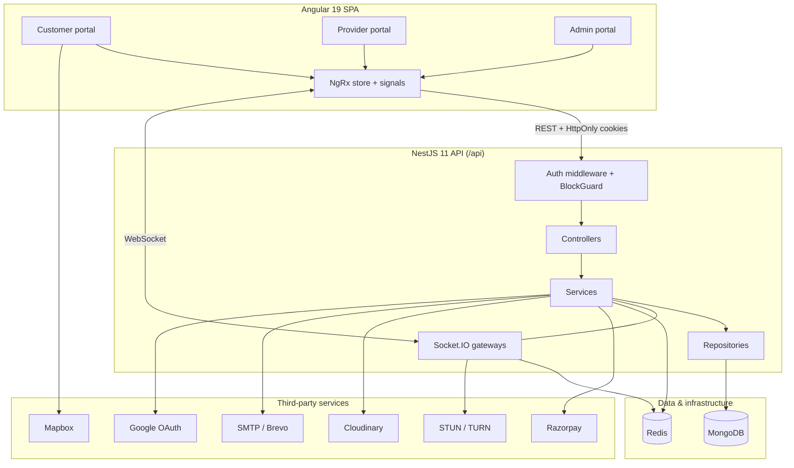

# HomeServe

HomeServe is a full-stack **home services marketplace** that connects customers with vetted local service providers and gives administrators the tools to govern the platform. It is built as a polyrepo inside this organization:

| Application | Stack | Repository |
| --- | --- | --- |
| REST API + realtime hub | NestJS 11, MongoDB, Redis, Socket.IO | `backend/` |
| Web SPA with three portals | Angular 19, NgRx, Tailwind CSS, Angular Material | `frontend/` |

The platform serves three roles — **Customer**, **Provider**, and **Admin** — through one API with role-aware authentication, authorization, and frontend route guards.

> **Status:** Actively developed. Core marketplace flows — discovery, booking, payment, subscriptions, wallet, realtime chat/video, and admin governance — are implemented. Automated test coverage is still limited and the project has not been independently audited for production security or scale.

---

## Tech stack

| Layer | Technologies |
| --- | --- |
| Frontend | Angular 19, TypeScript 5.7, RxJS 7.8, NgRx 19, Angular Material 19, Tailwind CSS 3.4, Mapbox GL, Apache ECharts, Socket.IO client, WebRTC |
| Backend | Node.js 20, NestJS 11, Express, Mongoose 8, Redis, Socket.IO, Passport, JWT, argon2 |
| Payments | Razorpay orders and signature verification |
| Media & documents | Cloudinary, Puppeteer PDF generation, ExcelJS, Handlebars email templates |
| Email | Nodemailer in development, Brevo in production |
| Infrastructure | Render deployment blueprint, GitHub Actions deploy workflow, Redis-backed Socket.IO adapter for multi-instance support |
| Testing | Jest + Supertest on the backend; Karma + Jasmine on the frontend |

---

## High-level architecture



MongoDB is the system of record. Redis backs sessions, OTPs, refresh-token families, access-token blacklisting, HTTP caching, payment/reservation locks, socket presence, call state, and the Socket.IO pub/sub adapter.

---

## Frontend UI

The Angular application is split into three role-specific portals. Routes are lazy-loaded and guarded, so customers, providers, and admins only load and access the areas meant for them.

### Customer portal

- **Landing and discovery** — Marketing landing page with service categories, featured providers, search, testimonials, safety information, and FAQ. Customers can search by service and location using Mapbox geocoding, filter providers, paginate results, and inspect provider profiles with tabs for about, services, reviews, and gallery.
- **Booking flow** — Customers add services to a cart, view a price breakup, choose an address and slot, reserve the slot in real time, apply coupons, and complete payment through Razorpay.
- **Bookings** — Customers can view upcoming and past bookings, inspect details, reschedule, cancel, and submit reviews after completion.
- **Account** — Profile management, avatar upload, saved providers, password change, wallet/refund history, notifications, and subscription information.
- **Communication** — Real-time chat with providers and WebRTC video calls, including incoming-call UI, draggable/minimizable call window, and reconnection handling.

### Provider portal

- **Dashboard** — Overview of bookings, earnings, pending payments, recent activity, and performance indicators.
- **Onboarding and KYC** — Provider signup, document upload, profile completion, and verification status tracking.
- **Service catalog** — Create, edit, toggle, delete, filter, and paginate offered services with images, pricing units, and category/profession mapping.
- **Availability** — Weekly default slots, date overrides, slot rules, buffer time, overlap validation, and unsaved-changes protection.
- **Bookings and operations** — Provider booking pipeline, status updates, completion, cancellation, rescheduling, and invoice downloads.
- **Analytics** — Performance, revenue, and area dashboards powered by ECharts, gated behind an active subscription with the analytics feature enabled.
- **Subscriptions and wallet** — Plan selection, upgrades, subscription status, wallet ledger, earnings, and refund/fine visibility.

### Admin portal

- **Dashboard** — Revenue trends, subscription breakdown, user growth, top-earning providers, satisfaction metrics, and approval overview.
- **Governance** — Provider KYC approval/rejection, customer and provider detail views, category/profession management, service oversight, coupon management, and ratings/reviews moderation.
- **Finance** — Transactions, wallet ledgers, sales reports, GST and commission settings, cancellation fees, and provider fines.
- **Support** — Complaint/report handling with investigation notes, resolution notes, and status transitions.
- **Exports** — PDF and Excel report downloads for users, bookings, transactions, and sales.

### UI engineering details

- Standalone Angular components with strict TypeScript and strict templates.
- Tailwind CSS plus a custom global design system for cards, inputs, buttons, skeletons, focus states, disabled states, and animations.
- Angular Material for dialogs, form controls, and prebuilt theming.
- Reusable tables, pagination, breadcrumbs, confirmation dialogs, skeleton loaders, empty/error states, and role-specific layouts.
- Responsive layouts including a dedicated mobile bottom navigation for customers.
- ECharts for analytics dashboards and Mapbox GL for location picking and provider discovery.
- Toastr notifications, a global spinner, view transitions, and route-level scroll preservation where needed.

---

## Frontend architecture

The SPA bootstraps through `bootstrapApplication` with a centralized `app.config.ts` that registers:

- Global error handling.
- Animation and toast/spinner modules.
- Router features such as view transitions and controlled scroll behavior.
- `provideHttpClient` with an authentication interceptor.
- NgRx root store, feature reducers, effects, and DevTools.
- Date pipes and environment initializers.

Key frontend layers:

| Layer | Responsibility |
| --- | --- |
| `core/services` | Domain API clients for auth, bookings, payments, subscriptions, chat, notifications, analytics, admin, and more |
| `core/guards` | Auth, guest, profile, subscription, analytics-feature, and root redirect guards |
| `core/interceptors` | Adds credentials and role hints, centralizes 401/403 and business-error handling |
| `core/models` | Frontend domain models and request/response shapes |
| `core/utils` | Validators, date helpers, error handling, table generation, socket retry helpers |
| `modules/pages` | Customer, provider, admin, and subscription page components |
| `modules/routes` | Role-partitioned lazy route definitions |
| `modules/shared/components` | Reusable business and presentation components |
| `store` | NgRx slices, actions, reducers, selectors, effects, and persistence |
| `environments` | Dev and production API/socket URLs, keys, regexes, and map configuration |

The HTTP layer uses cookie-based sessions with `withCredentials`. A functional interceptor attaches a role hint header, normalizes backend error codes, redirects expired subscriptions to the plans page, and logs the user out on unauthorized responses.

Realtime features are built around a typed socket base service with namespaced clients for notifications, chat, reservations, and video calls. Socket connections are tied to authentication state in the role layouts and cleaned up on destroy.

---

## Frontend store design

NgRx manages state that is shared across routes or combined from REST and socket streams. Local, short-lived state uses Angular signals instead.

| Slice | Responsibility |
| --- | --- |
| `auth` | Login, Google login, logout, user type, authenticated status, and error state |
| `users` | Customer/provider entities for tables and admin views, with entity adapters and partial updates |
| `provider` | Selected provider profile and optimistic updates for services, slots, and gallery images |
| `customer` | Customer profile, saved providers, update flows, password/avatar changes, and location-derived selectors |
| `chat` | Chat list, cursor-paginated messages, presence, and optimistic message reconciliation |
| `notification` | Cursor-paginated notifications, unread counts, socket upserts, and mark-read flows |

Important store patterns:

- Functional effects with `inject()` instead of class-based effects.
- `@ngrx/entity` adapters with deterministic sorting.
- Selective `localStorage` persistence for auth identity only — no tokens or personal data are persisted.
- Optimistic chat messages keyed by `clientMessageId` and reconciled when the server confirms them.
- `switchMap` to cancel stale provider searches when filters change quickly.
- `debounceTime` for favorite toggles and header search.
- Signals for cart state, subscription cache, selected booking address/slot, and view-local filters.

This split keeps global session and cross-route data in NgRx while avoiding unnecessary store boilerplate for local UI state.

---

## Backend architecture

The backend is a NestJS 11 API organized into feature modules. Each module generally follows:

```text
controllers → services (interface + implementation) → repositories → MongoDB
```

Global cross-cutting concerns are applied at bootstrap:

- `ValidationPipe` with whitelist, transformation, and rejection of unknown fields.
- Global `AuthMiddleware` for token validation and refresh rotation.
- Global `BlockGuard` to reject blocked or inactive users.
- Global exception filter returning a consistent envelope:
  `{ statusCode, message, code, timestamp }`.
- CORS allowlist with credentials.
- Redis-backed sessions and Socket.IO adapter.
- `/api` global prefix and health endpoint.

### Backend modules

| Module | Responsibility |
| --- | --- |
| `auth` | Signup, OTP, login, Google OAuth, password reset, token service, logout |
| `customer` | Customer profile, search, saved providers, avatar and gallery operations |
| `providers` | Provider profile, KYC documents, discovery, reviews, availability slots, dashboard, analytics |
| `provider-service` | Provider service catalog, limits, toggles, images, pagination |
| `category` | Professions, service categories, search, active/inactive lifecycle |
| `availability` | Weekly availability, date overrides, slot rules, validation |
| `bookings` | Booking creation, pricing, review, cancellation, refunds, reschedule, invoices |
| `cart` | Single-provider cart with duplicate and inactive-service checks |
| `coupons` | Coupon CRUD, validation, expiry, and discount application |
| `payment` | Razorpay order creation, verification, settlement, lock release |
| `plans` | Subscription plans and feature registry |
| `subscriptions` | Subscribe, renew, upgrade, history, latest/active status |
| `wallet` | Wallet balances and ledger views for customers and providers |
| `reports` | Complaints and investigation workflow |
| `users` | Admin controllers for users, approvals, bookings, transactions, reports, settings |
| `websockets` | Chat, notification, reservation, and video-call gateways |
| `landing` | Public landing data and unauthenticated category search |

`src/modules/slots/` exists as a placeholder; live slot logic is in `availability`, `providers`, and `bookings`.

### Data and Redis usage

MongoDB schemas include base users with discriminators for customers/providers, bookings with embedded slot and transaction data, provider services, availability, reservations, coupons, subscriptions, wallets, ledgers, chats, messages, notifications, reports, and admin settings.

Important database safeguards include:

- Unique email and username indexes.
- Compound unique index on provider slots to prevent double booking.
- Unique reservation index with TTL expiry.
- Partial unique index for active provider services.
- Cursor indexes for messages and notifications.
- GeoJSON `2dsphere` indexes for location search.
- Aggregation pipelines with zero-safe fallbacks and consistent filtered counts.

Redis is used for sessions, OTPs, refresh-token families, access-token blacklist, payment locks, socket-user maps, call sessions, HTTP cache, and Socket.IO pub/sub.

---

## Feature-by-feature implementation

### Authentication and onboarding

- Credential login and signup are backed by argon2id password hashing.
- Signup and password reset use short-lived email OTPs stored in Redis.
- Google OAuth supports customer and provider accounts and rejects admin login through OAuth.
- Access and refresh tokens are delivered as HttpOnly cookies.
- Refresh tokens rotate on use, and reuse detection invalidates the entire token family.
- Access tokens are blacklisted on logout with their remaining TTL.
- The frontend stores only non-sensitive identity fields and derives role-aware navigation from the authenticated state.

### Provider discovery and catalog

- Customers search providers by service, location, category, and coordinates.
- Geo search uses `$geoNear` plus radius filtering.
- Active subscriptions can influence provider search priority.
- Provider profiles include services, reviews, gallery, work images, and availability.
- Provider service CRUD validates category/profession relationships, enforces plan listing limits, and cleans up uploaded images when duplicate creation fails.
- Admin-controlled category/profession activation cascades into provider services, cart validation, and booking validation.

### Availability, slots, and reservations

- Providers configure weekly default slots, date overrides, and slot rules.
- Overlap checks, start/end validation, UTC-midnight normalization, and past-date rejection prevent invalid schedules.
- Slot generation merges weekly availability, overrides, existing bookings, and temporary reservations with buffer time.
- Reservations use a 15-minute TTL and a unique slot index so two customers cannot hold the same slot.
- The checkout screen joins a reservation socket room and waits for a reservation result before saving the booking.

### Cart, booking, and checkout

- A customer cart is scoped to one provider and rejects duplicate or inactive services.
- Booking creation validates the slot, provider/service/category status, address, phone, reservation ownership, and overlapping bookings.
- A Redis payment lock is acquired when a booking is created and released after verification or failure.
- Price breakup includes service cost, duration, coupon discount, taxes, and fees.
- Payment failure releases the slot/reservation and unlocks the payment flow.
- Successful payment marks the booking paid, clears the cart, creates ledger entries, notifies the provider, and releases the lock.

### Payments, coupons, and wallets

- Razorpay orders are created server-side and verified with signature validation.
- Payment verification handles booking and subscription payments, GST/commission breakup, admin wallet credit, and notifications.
- Coupons support fixed/percentage discounts, usage limits, expiry windows, and per-provider/category/profession scoping where applicable.
- Cancellation refunds create a shared journal entry across customer credit, provider fine, and admin debit.
- Wallet ledgers expose transaction history and provider overviews.
- Wallet-as-a-direct-payment-method is designed but not fully wired into Razorpay verification.

### Chat, notifications, and video calls

- Chat uses cursor pagination instead of offset pagination, with stable message IDs and read-marking scoped to the receiver.
- The frontend renders optimistic pending messages and reconciles them with confirmed messages.
- Notifications combine REST pagination with socket pushes, unread counts, and template-based messages.
- Socket gateways authenticate the handshake from cookies and emit `token:expired` before disconnecting when authentication fails.
- Video calls use server-owned Redis call sessions, room-scoped signaling, ringing timeouts, reconnect grace, participant checks, and idempotent finalization.
- TURN credentials are generated behind an authenticated backend endpoint instead of being bundled into the frontend.

### Subscriptions, plans, and analytics

- Plans define feature flags such as support, listing limit, analytics dashboard, and search priority.
- Free-tier accounts receive an active free subscription with unlimited or elevated listing rules where configured.
- Paid subscriptions start unpaid/inactive until Razorpay verification succeeds.
- Upgrades support proration rules, including full credit within the initial window and unused-day credit afterwards.
- Expired subscriptions are excluded by date window, so users can renew instead of seeing an expired plan as current.
- Provider analytics bundles are protected by an active subscription and the analytics feature flag.

### Admin governance

- Admin login is separate from customer/provider login.
- Admin controllers are guarded by an admin role guard.
- Provider KYC approval requires documents and updates verification status.
- Admin tools include user details, approvals, category/coupon management, booking oversight, reviews, transactions, sales reports, settings, complaints, and dashboards.
- Reports/reviews can be moderated, and complaint resolution requires a resolution note before terminal status.
- PDF/Excel exports support operational reporting.

---

## Real-world problems solved

| Problem | What was done | Result |
| --- | --- | --- |
| Refresh-token reuse and silent-refresh races | Redis session families with one-time JWT IDs, rotated-JTI tracking, atomic Lua rotation, a short concurrent-replay window, and family destruction on replay | Stolen or replayed refresh tokens are rejected and the whole session family is revoked |
| Access tokens remained valid after logout | Redis blacklist keyed by token with remaining TTL | Logout immediately invalidates the access token |
| Client `x-user-type` header could be spoofed | User type is derived from the validated JWT payload | Role decisions no longer trust a client-supplied header |
| Public landing page returned 403 for guests | Added landing routes to auth/guard bypass lists and created a dedicated public category-search endpoint | Guests can browse marketing and discovery data without cookies |
| Double booking and payment races | Compound slot uniqueness, 15-minute reservations, Redis payment locks, payment guard checks, and `finally`-based lock release | Two users cannot confirm the same slot and failed payments do not leave locks behind |
| Stale filter results in the UI | Switched search/filter streams to `switchMap` so older in-flight requests are cancelled | Fast typing/filtering no longer overwrites newer results |
| Pagination totals disagreed with filtered rows | Moved filtering into shared aggregation builders and fixed count/list pipelines | Tables now show totals that match visible filters |
| New-provider dashboard crashed on empty aggregates | Added zero-safe aggregate fallbacks and null-safe frontend getters | New providers see zeroes instead of a broken dashboard |
| Expired subscriptions blocked renewal | Added date-window queries and an explicit latest-subscription endpoint | Expired users can see status and renew correctly |
| Free-tier signup failed with HTTP 400 | Added free-tier duration to the shared enum and mapped it through schema/DTO/storage | Free-tier onboarding works end-to-end |
| Signed Cloudinary avatar URLs expired mid-session | Increased signed URL lifetime and signed avatars in more backend responses; added image error fallbacks | Fewer broken profile images during long sessions |
| Chat scroll position jumped when loading older messages | Cursor pagination plus post-render scroll restoration outside the Angular zone | Older messages load without losing the user’s place |
| Duplicate cart inserts produced generic errors | Added a specific cart conflict code and made the interceptor the single source of toasts | Clear user feedback and no duplicate notifications |
| TURN secrets were exposed in the frontend bundle | Moved TURN credential generation to an authenticated backend endpoint with caching and STUN fallback | WebRTC relay credentials are no longer shipped to browsers |
| Socket presence leaked on disconnect | Centralized socket authentication/unauthentication and Redis socket-set cleanup | Fewer stale presence records and duplicate listeners |
| Sales reports double-counted multi-service bookings | Deduplicated bookings per ID before aggregation | Revenue and trend totals are accurate |

---

## Current limitations and next work

- Automated tests are minimal: a small number of focused unit tests exist, but there is no e2e suite and no frontend CI workflow.
- There is no shared contract package or Swagger/OpenAPI spec between frontend and backend; models and enums are duplicated.
- Provider/customer role guards are less complete than the admin guard.
- Unpaid bookings can still hold slots until cleanup; automatic cancellation after a payment-grace period is planned.
- Wallet checkout is future-proofed but not fully wired into Razorpay verification.
- No Docker setup or infrastructure-as-code exists beyond the Render blueprint.
- A `.env.example` is not committed; environment variables are documented in the root and backend READMEs.
- Deployment URLs and cookie security settings should be reviewed before production use.

---

## Local development

```bash
# Backend
cd backend
pnpm install
cp .env.development .env
pnpm run start:dev
```

```bash
# Frontend
cd frontend
npm install
npm start
```

The admin account is created with:

```bash
pnpm run seed:admin -- -e admin@example.com -p 'ChangeMe@123'
```

The backend listens on port `5000` by default and exposes REST endpoints under `/api`. The Angular dev server runs on port `4200`.

---

## Summary

HomeServe is a role-based marketplace built with a layered NestJS API and a component-driven Angular SPA. Its main engineering focus is correctness under real-world conditions: secure sessions, race-safe payments and bookings, reliable realtime communication, consistent pagination and reporting, and a UI that stays usable across loading, error, empty, and optimistic states.
